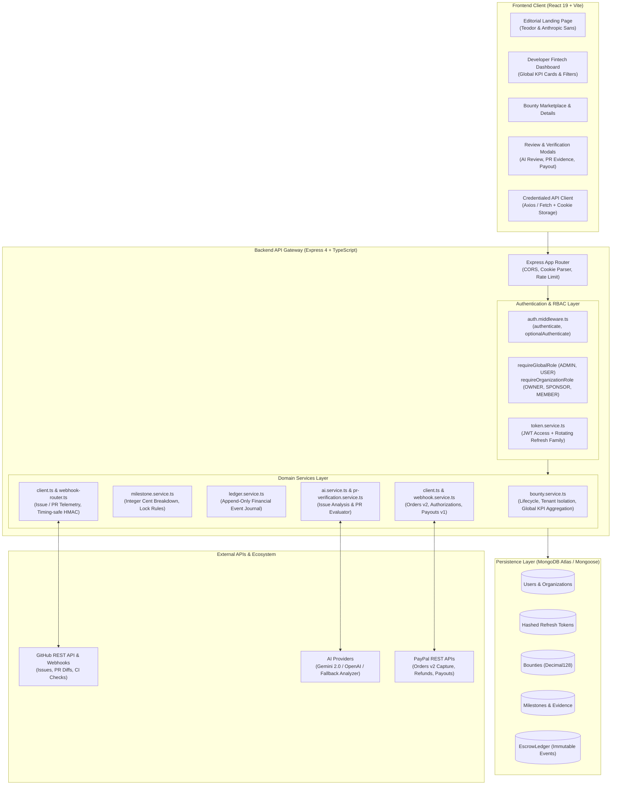
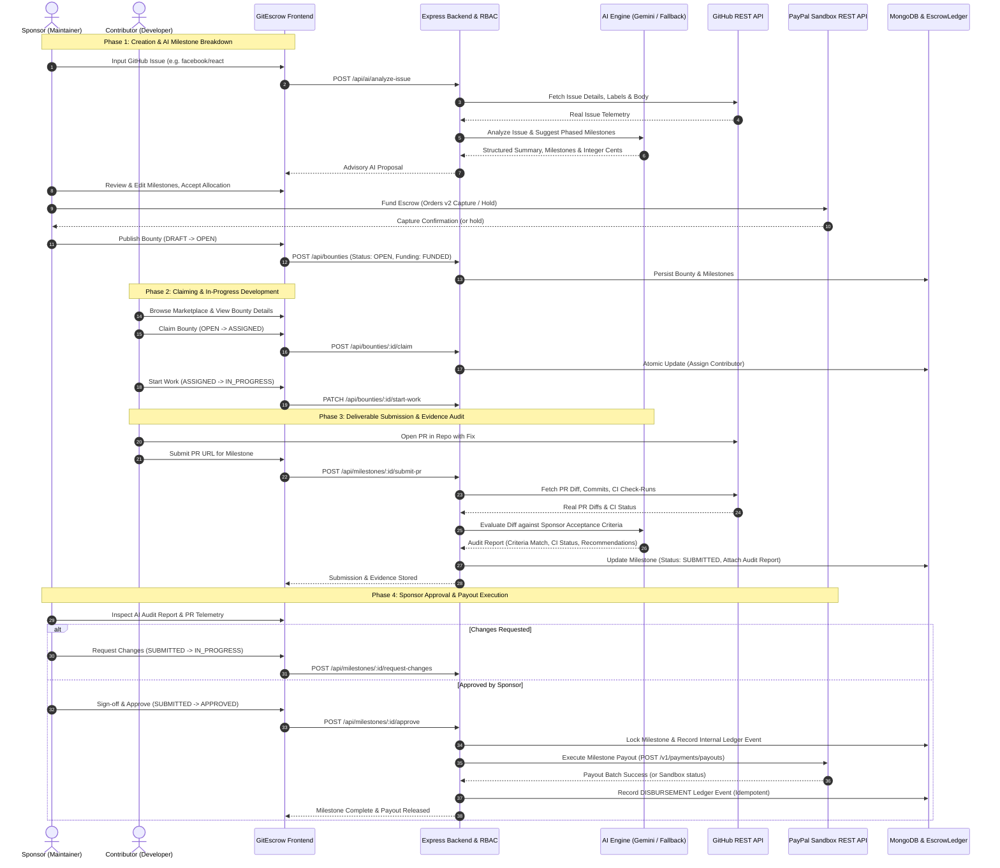

# GitEscrow

> Trustless, AI-powered GitHub contribution verification and milestone payment platform developed for the **PayPal AI Hackathon 2026**.

[](LICENSE)
[](https://www.typescriptlang.org/)
[](https://react.dev/)
[](https://nodejs.org/)
[](server/scripts/)

---

## 1. Project Title & Tagline

**GitEscrow**: _Autonomous AI Contribution Verification with Human-Authorized Milestone Disbursements via PayPal._

GitEscrow establishes a mathematically verified, milestone-based bridge between open-source project sponsors, maintainers, and external contributors. By combining deterministic AI issue decomposition, automated GitHub pull request telemetry analysis, and an append-only financial audit journal, GitEscrow eliminates contribution ambiguity while ensuring financial safety.

---

## 2. Project Overview

Open-source software powers modern digital infrastructure, yet funding open-source work remains notoriously difficult and risky for both sides:

- **Sponsors** hesitate to fund bounties upfront because deliverables often fail to meet requirements, miss edge cases, or introduce security regressions.
- **Contributors** avoid complex bounties because they fear uncompensated labor, moving goalposts, or maintainer ghosting after submitting substantial code.

GitEscrow resolves this trust gap by implementing a structured, milestone-driven lifecycle:

1. **Sponsor Funds Milestone Escrow**: Funds are captured into platform escrow via PayPal Orders v2 upon milestone setup.
2. **AI Issue Decomposition**: Real GitHub issues are ingested and decomposed into structured summaries, discrete technical milestones, and measurable acceptance criteria with exact integer-cent reward distribution.
3. **Contributor Claims & Builds**: Contributors claim bounties, view explicit criteria, and submit real GitHub Pull Requests.
4. **AI Evidence Verification**: GitEscrow queries live GitHub telemetry (diffs, commit history, and CI check-runs) and evaluates deliverables against sponsor criteria using a deterministic AST and semantic matching engine with multi-provider LLM support.
5. **Human Sponsor Authority**: AI analysis is strictly consultative. Sponsors review evidence and explicitly sign off.
6. **Milestone Disbursement**: Upon sponsor approval, the milestone is permanently locked and funds are disbursed to the contributor's verified PayPal address, recording an immutable audit event in the platform ledger.

---

## 3. Problem Statement

1. **All-or-Nothing Bounties**: Traditional bounty platforms treat entire issues as monolithic tasks. If a contributor completes 80% of an architecture rewrite but stalls, they receive 0%, and the sponsor has zero deployable progress.
2. **Ambiguous Requirements & Moving Goalposts**: Issue descriptions are often colloquial, lacking clear acceptance criteria, test specifications, and boundary rules.
3. **Manual Review Fatigue**: Maintainers spend hours manually checking whether PRs fulfill original issue requirements, run tests, and adhere to architecture patterns.
4. **Payment Risk & Lack of Auditability**: Maintainers and contributors have no shared, tamper-proof record of what criteria were agreed upon, what evidence was submitted, when approval occurred, and which transaction hash paid the contributor.

---

## 4. The Solution

GitEscrow re-engineers open-source funding into an audited, phased delivery pipeline:

- **Fractional Milestones with Integer-Cent Precision**: Issues are split into 2–4 sequential milestones (e.g. Scaffolding, Core Logic, Integration & Tests) with mathematically exact cent allocations (`distributeCents()`) avoiding rounding drift.
- **Consultative AI Decomposition**: Large Language Models (Gemini 2.0 / OpenAI) generate actionable criteria from real GitHub issues, while built-in AST fallback analyzers ensure zero crash vulnerability.
- **Objective Evidence Gathering**: PR branches, changed files, diffs, commits, and GitHub Actions CI checks are gathered directly from GitHub's REST API.
- **Deterministic Evaluation with Human Sign-off**: Deliverables are audited against each criterion. The AI provides a structured PASS/FAIL advisory verdict, but only the authenticated sponsor has authority to trigger payouts.
- **Append-Only Financial Ledger**: Every funding hold, milestone lock, sponsor approval, and payout event is immutably recorded with unique idempotency keys in MongoDB.

---

## 5. Key Features

- **Public Editorial Landing Page**: Editorial, typography-led public experience featuring Teodor Serif and Anthropic Sans Display, live product showcases, and interactive technical workflows.
- **Authenticated Developer-Fintech Dashboard**: Dark developer-tool interface (`#0D0D0D` graphite background, `#15191D` charcoal surfaces) displaying global KPI metrics across all authorized records.
- **Global KPI Aggregation**: High-performance MongoDB aggregation pipeline (`GET /api/bounties/summary`) calculating platform-wide totals (Active Bounties, Sponsored Bounties, Awaiting Sign-off, Escrow Funded) across paginated boundaries.
- **Multi-Role Authentication & RBAC**: JWT access tokens (15m) paired with HttpOnly rotating refresh cookies (7d), family reuse invalidation, global roles (`USER`, `ADMIN`), and organization roles (`OWNER`, `SPONSOR`, `MEMBER`).
- **Real GitHub Telemetry Ingestion**: Direct integration with GitHub REST API and HMAC SHA-256 webhooks for real repository issues and pull requests (`facebook/react`).
- **Multi-Provider AI Analysis**: Native support for Google Gemini 2.0 and OpenAI models, reinforced by an offline AST & Semantic Fallback Analyzer with prompt injection isolation.
- **PayPal Sandbox Payment Pipeline**: End-to-end integration with PayPal Orders v2 (Capture), Payments v2 (Refunds), Authorizations (Void/Capture), and Payouts v1 (Disbursement).
- **Contributor Payout Profile**: Secure PayPal recipient email validation and address presentation with strict tenant isolation.
- **Hallmark Modern-Minimal Design**: Built according to Hallmark design principles with centralized OKLCH design tokens (`tokens.css`) and lifecycle-safe GSAP motion.

---

## 6. Screenshots

The repository includes genuine browser screenshots captured across Desktop (1440x900) and Mobile (390x844) viewports located in `artifacts/screens/`:

| View                          | Desktop Screenshot                                             | Mobile Screenshot                                             | Description                                                                    |
| :---------------------------- | :------------------------------------------------------------- | :------------------------------------------------------------ | :----------------------------------------------------------------------------- |
| **Public Marketplace**        | `artifacts/screens/01-public-marketplace-desktop.png`          | `artifacts/screens/01-public-marketplace-mobile.png`          | Unauthenticated bounty grid with status filters, search, and demo badges       |
| **User Login**                | `artifacts/screens/02-login-desktop.png`                       | `artifacts/screens/02-login-mobile.png`                       | Authentication form with credential fields and security notices                |
| **Registration**              | `artifacts/screens/03-registration-desktop.png`                | `artifacts/screens/03-registration-mobile.png`                | Developer registration form with password requirements                         |
| **Authenticated Marketplace** | `artifacts/screens/04-authenticated-marketplace-desktop.png`   | `artifacts/screens/04-authenticated-marketplace-mobile.png`   | Marketplace with active session badge, user profile link, and role pill        |
| **Bounty Details**            | `artifacts/screens/05-bounty-details-desktop.png`              | `artifacts/screens/05-bounty-details-mobile.png`              | Bounty view with GitHub issue link, sponsor info, and tab navigation           |
| **Milestone Breakdown**       | `artifacts/screens/06-milestones-desktop.png`                  | `artifacts/screens/06-milestones-mobile.png`                  | Sequential milestone breakdown with deliverables and completion states         |
| **Escrow Ledger**             | `artifacts/screens/07-escrow-ledger-desktop.png`               | `artifacts/screens/07-escrow-ledger-mobile.png`               | Append-only financial audit trail with event types and idempotency keys        |
| **Create Bounty**             | `artifacts/screens/08-create-bounty-desktop.png`               | `artifacts/screens/08-create-bounty-mobile.png`               | Interactive milestone builder with dynamic sum calculation and validation      |
| **User Profile & Payouts**    | `artifacts/screens/09-user-profile-desktop.png`                | `artifacts/screens/09-user-profile-mobile.png`                | User credentials, RBAC permissions, and organization memberships               |
| **AI Analysis Review Modal**  | `artifacts/screens/10-ai-analysis-modal-desktop.png`           | `artifacts/screens/10-ai-analysis-modal-mobile.png`           | AI decomposition review drawer with criteria checklist and allocation metrics  |
| **Bounty Form (AI Applied)**  | `artifacts/screens/11-bounty-form-ai-applied-desktop.png`      | `artifacts/screens/11-bounty-form-ai-applied-mobile.png`      | Populated draft with applied AI milestones, criteria, and sponsor verification |
| **Contributor Submit PR**     | `artifacts/screens/12-contributor-submit-pr-modal-desktop.png` | `artifacts/screens/12-contributor-submit-pr-modal-mobile.png` | Contributor PR submission modal with live repository validation and criteria   |
| **AI PR Verification Modal**  | `artifacts/screens/13-pr-verification-modal-desktop.png`       | `artifacts/screens/13-pr-verification-modal-mobile.png`       | Evidence-based AI verification audit report with criteria checks and CI runs   |
| **Milestone PR Applied View** | `artifacts/screens/14-milestone-pr-applied-desktop.png`        | `artifacts/screens/14-milestone-pr-applied-mobile.png`        | Milestone details card showing submitted PR metadata and audit history         |

---

## 7. Complete Technology Stack

### Frontend Application

- **Framework**: React 19.3.1
- **Build System**: Vite 8.3.5, TypeScript 5.7.3
- **Styling**: Tailwind CSS v4, Hallmark centralized OKLCH design tokens (`tokens.css`, `base.css`)
- **Typography**: Teodor Serif (Display), Anthropic Sans Display (Headings & Body), Atkinson Hyperlegible Mono (Financial numbers & IDs)
- **Animation**: GSAP 3.15, `@gsap/react` 2.1 (lifecycle-safe with reduced-motion support)
- **Linter**: Oxlint 1.89.0

### Backend API & Services

- **Runtime**: Node.js v18+ (tested on Node v24)
- **Framework**: Express 4.21.2, TypeScript 5.7.3
- **Execution / Tooling**: TSX 4.19.2 (TypeScript Execute)
- **Database**: MongoDB Atlas / Mongoose 8.9.5
- **Security & Crypto**: Bcryptjs 3.0 (work factor 12), JsonWebToken 9.0, Timing-Safe HMAC SHA-256
- **Validation**: Zod 4.6.7 (strict request and schema validation)
- **Rate Limiting**: Express-rate-limit 8.7.2

### External APIs & Integrations

- **Payment Processing**: PayPal REST APIs (v2 Orders, v2 Payments, v1 Payouts, Webhooks)
- **Code & Telemetry**: GitHub REST API v3, GitHub Webhooks
- **Artificial Intelligence**: Google Gemini 2.0 (`@google/genai`), OpenAI API, plus built-in AST Semantic Analyzer

---

## 8. System Architecture

The GitEscrow platform is organized as a layered monorepo with clean separation between presentation, routing, authentication, business domain services, and immutable persistence:



---

## 9. Application Workflow

The end-to-end lifecycle illustrates how sponsors create bounties, how contributors submit deliverables, how AI verifies criteria against real GitHub telemetry, and how human sponsors authorize milestone disbursements:



---

## 10. PayPal Integration Details & Disclosures

GitEscrow enforces strict financial truthfulness across all payment operations. All verification scripts interact with PayPal Sandbox endpoints and maintain idempotent state.

### Implemented PayPal Workflows

1. **Sandbox Payment Capture (`Orders v2`)**:
   - Sponsors fund bounties using PayPal Checkout (`POST /v2/checkout/orders` with `intent: CAPTURE`).
   - The capture ID is verified against PayPal before the bounty transitions from `DRAFT` to `OPEN` (`FUNDED`).
   - Every capture ID is enforced as globally unique in the database to prevent replay or multi-bounty funding duplication.

2. **Refund Workflow (`Payments v2`)**:
   - When a funded bounty is cancelled by an authorized sponsor without assigned deliverables, GitEscrow invokes `POST /v2/payments/captures/{capture_id}/refund`.
   - Supports both partial and full balance refunds.
   - Payout-in-progress guards prevent cancellation while a milestone payout is in flight.

> 4. **Supported Payout Workflow (`Payouts v1`)**:

- Once a milestone is approved by the human sponsor, GitEscrow executes a payout batch (`POST /v1/payments/payouts`) targeting the contributor's registered PayPal email.
- The disbursement record stores the payout batch ID, item ID, and fees.
- Network timeout recovery handles ambiguous 5xx responses by setting status `UNCERTAIN` and reconciling authoritatively rather than issuing duplicate payouts.

4. **Sponsor Approval & Milestone Lock**:
   - Milestone approval locks the deliverable irreversibly.
   - Duplicate approval attempts return HTTP 400 Bad Request to guarantee that payouts cannot be triggered more than once for a single milestone.

5. **Internal Financial Ledger (`EscrowLedger`)**:
   - Every transaction (HOLD, MILESTONE_APPROVAL, DISBURSEMENT, REFUND) writes an immutable, append-only document with a cryptographic idempotency key.
   - Mutation guards prevent modifying or deleting ledger entries.

### Mandatory Compliance & Sandbox Disclosures

> [!WARNING]
> **Regulatory Status & Financial Disclaimers**:
>
> 1. **Not a Regulated Financial Escrow**: GitEscrow is a hackathon prototype demonstrating technical API integration and milestone orchestration. It is **not** a licensed financial institution, trust company, or legally regulated escrow entity under any federal, state, or international jurisdiction, and does not claim to hold deposits in a regulated escrow account.
> 2. **Sandbox Payout Eligibility Notice**: The automated milestone payout capability was validated using a **US Business Sandbox account**. PayPal restricts automated Payouts API sender permissions in certain geographic jurisdictions (e.g. accounts registered in India receive `USER_COUNTRY_NOT_SUPPORTED`). Production payout availability is subject to PayPal's regional underwriting and commercial approval.
> 3. **No Production Payment Claims**: GitEscrow is configured strictly for the PayPal Sandbox environment (`api-m.sandbox.paypal.com`). Do not submit live credentials or attempt real financial transfers with this repository.

---

## 11. AI Integration Details

GitEscrow incorporates artificial intelligence to streamline issue breakdown and PR auditing while enforcing strict safety boundaries:

1. **GitHub Issue Analysis**:
   - The backend ingests real GitHub issue metadata (title, body, labels, author).
   - The AI decomposes the issue into 2 to 3 chronological milestones with clear scopes (e.g. Scaffolding, Core Logic, Testing/Docs).
   - Generates 2 to 4 measurable acceptance criteria per milestone.
   - Distributes the bounty reward across milestones in integer cents (`distributeCents()`), guaranteeing mathematical equality to the total.

2. **Pull Request Evidence Verification**:
   - Contributor PR submissions trigger an evidence audit that retrieves the PR diff, commit list, changed files, and GitHub Actions CI check-runs.
   - Deliverables are evaluated against each sponsor-defined acceptance criterion.
   - The engine generates an audit report separating objective facts (files modified, test runs) from consultative assessments.

3. **Prompt Injection Containment**:
   - Untrusted issue and PR text are encapsulated within strict structural delimiters.
   - System prompts explicitly instruct models to ignore embedded directives attempting to override evaluation logic or grant automatic approvals.

4. **Advisory Nature of AI**:
   - **AI Never Disburses Funds**: AI models do not hold credentials, cannot make financial calls, and are isolated from the EscrowLedger database writer.
   - **Sponsor retains 100% Final Authority**: AI recommendations are consultative. The human sponsor must review the evidence and explicitly sign off to transition a milestone to `APPROVED`.

---

## 12. GitHub Integration

GitEscrow interacts with GitHub via authenticated REST APIs and timing-safe webhooks:

- **REST API Client**: Retrieves repository metadata, issues, comments, pull requests, unified diffs, and commit check-runs.
- **Timing-Safe HMAC SHA-256 Webhooks**: Validates `X-Hub-Signature-256` signatures to prevent timing attacks and payload tampering.
- **Duplicate Delivery Deduplication**: The `WebhookDelivery` collection stores `x-github-delivery` IDs to drop duplicate webhook events safely.
- **Graceful Rate-Limit Fallback**: When unauthenticated GitHub API rate limits (60 req/hr) are reached, the application utilizes verified local snapshots for test issues (`facebook/react #38090`), ensuring tests pass reliably.

---

## 13. Security and Authorization

GitEscrow enforces defense-in-depth across every layer:

- **Bcrypt Password Hashing**: Passwords are saved with bcrypt using work factor 12. Passwords shorter than 8 characters are rejected.
- **JWT & HttpOnly Cookies**: Short-lived access tokens (15m) are sent via headers; refresh tokens (7d) are stored in HttpOnly, SameSite cookies.
- **Refresh Token Rotation & Family Revocation**: Each refresh request rotates the token. If an expired or already-used refresh token is presented, the entire token family is immediately revoked, protecting against token theft.
- **Anti-Enumeration Protections**: Login failure returns identical generic messages (`"Invalid email or password"`) regardless of whether the email or password was invalid.
- **Role-Based Access Control (RBAC)**:
  - Global roles: `USER`, `ADMIN`.
  - Organization roles: `OWNER`, `SPONSOR`, `MEMBER`.
- **Tenant Isolation**: Private and draft bounties belonging to an organization are completely hidden from outsiders and unauthenticated users.
- **Self-Approval Guard**: Contributors cannot review or approve their own milestones.
- **One-Time Admin Bootstrap**: An initial administrator can be established via `POST /api/auth/setup-admin` using `ADMIN_SETUP_SECRET`. Once an admin exists, the endpoint permanently locks.

---

## 14. Installation Prerequisites

Ensure your system meets the following requirements:

- **Node.js**: `v18.0.0` or higher (tested on Node `v24.16.0`)
- **npm**: `v9.0.0` or higher
- **MongoDB**: Local MongoDB instance (`mongodb://localhost:27017`) or free MongoDB Atlas cluster
- **PayPal Developer Account**: Sandbox account at [https://developer.paypal.com](https://developer.paypal.com)
- **GitHub Personal Access Token**: Optional but recommended to avoid public rate limits: [https://github.com/settings/tokens](https://github.com/settings/tokens)
- **Gemini or OpenAI API Key**: Optional for live LLM queries; the system runs cleanly offline using the built-in fallback analyzer if omitted.

## 15. Environment Configuration

GitEscrow includes a canonical configuration template [.env.example](.env.example).

Copy the example file to `.env` in the project root and `server/.env`:

```bash
cp .env.example .env
cp .env.example server/.env
```

### Key Configuration Variables

```ini
# Application Ports & URLs
PORT=5000
FRONTEND_URL=http://localhost:5173
NODE_ENV=development

# MongoDB Connection
MONGODB_URI=mongodb://localhost:27017/gitescrow

# JWT & Admin Security
JWT_ACCESS_SECRET=your_jwt_access_secret_min_32_bytes_here
JWT_REFRESH_SECRET=your_jwt_refresh_secret_min_32_bytes_here
JWT_ACCESS_EXPIRES_IN=15m
JWT_REFRESH_EXPIRES_IN=7d
ADMIN_SETUP_SECRET=your_one_time_admin_bootstrap_secret_here

# PayPal Sandbox Configuration
PAYPAL_CLIENT_ID=your_paypal_sandbox_client_id_here
PAYPAL_CLIENT_SECRET=your_paypal_sandbox_client_secret_here
PAYPAL_BASE_URL=https://api-m.sandbox.paypal.com
PAYPAL_WEBHOOK_ID=your_paypal_sandbox_webhook_id_here
PAYPAL_SANDBOX_CONTRIBUTOR_EMAIL=sb-contributor@personal.example.com

# GitHub Configuration
GITHUB_TOKEN=ghp_your_github_token_here
GITHUB_WEBHOOK_SECRET=your_github_webhook_secret_here
GITHUB_API_BASE_URL=https://api.github.com

# AI Provider Configuration (Optional)
GEMINI_API_KEY=your_gemini_api_key_here
OPENAI_API_KEY=your_openai_api_key_here
```

---

## 16. Installation Instructions

Clone the repository and install all dependencies:

```bash
# 1. Clone repository
git clone https://github.com/TanmayRongre/GitEscrow.git
cd GitEscrow

# 2. Install dependencies across root, server, and client
npm run install:all
```

---

## 17. Development Startup Commands

Start both the backend API and frontend client concurrently with a single command:

```bash
# Start both Backend (Port 5000) and Frontend (Port 5173) concurrently
npm run dev
```

Alternatively, run them in separate terminal windows:

```bash
# Terminal 1: Start Backend API (Port 5000)
npm run dev:server

# Terminal 2: Start Frontend Client (Port 5173)
npm run dev:client
```

Open your browser to `http://localhost:5173`.

---

## 18. Testing Instructions

All 171 automated backend tests run deterministically and clean up their test fixtures:

```bash
# 1. Authentication & RBAC Suite (31 tests)
npm run test:auth

# 2. Bounty Lifecycle, Milestones & Global KPI Metrics (48 tests)
npm run test:bounties

# 3. Financial Integrity & Payouts Suite (40 tests)
npm run test:payouts

# 4. PR Verification & Evidence Evaluation (19 tests)
npm run test:pr-verification

# 5. Timing-Safe GitHub Webhooks (5 tests)
npm run test:webhook

# 6. End-to-End 10-Step Contributor Workflow Audit (28 tests)
npm run audit:2c1
```

### Full Verification & Build Verification

```bash
# Build server TypeScript (tsc)
npm run build:server

# Build client production bundle (Vite)
npm run build:client

# Verify AI issue analysis & cent allocation (17 tests)
npx tsx server/scripts/test-ai-analysis.ts
```

---

## 19. Demo Account Instructions (Judge Guide)

To explore the application without setting up real PayPal or external developer accounts:

1. **Start the application** via `npm run dev` (or in separate terminals via `npm run dev:server` and `npm run dev:client`).
1. **Access the Public Website**: Navigate to `http://localhost:5173` to explore the Agiloft-inspired editorial landing page.
1. **Register a Demo Sponsor**:
   - Click **Register** in the top navigation.
   - Enter username: `demo_sponsor`, email: `sponsor@example.com`, password: `Password123!`.
   - You are automatically authenticated and redirected to the **Authenticated Dashboard** (`/dashboard`).
1. **Create a Bounty**:
   - Click **Create Bounty** in the navigation.
   - Enter Repository: `facebook/react`, Issue Number: `38090`.
   - Click **Analyze Issue with AI**. Review the structured summary and 3 generated milestones with integer-cent allocations.
   - Click **Apply to Bounty Form** and submit.
1. **Register a Demo Contributor**:
   - In a private/incognito window, register as `demo_contributor` (`contributor@example.com` / `Password123!`).
   - Navigate to **Profile**, enter your sandbox PayPal email (e.g. `sb-contributor@personal.example.com`), and save.
   - Browse the **Marketplace**, open the created bounty, and click **Claim Bounty**.
   - Submit a pull request URL (e.g. `https://github.com/facebook/react/pull/38090`) against Milestone #1.
1. **Sponsor Review & Approval**:
   - Return to the sponsor session.
   - Open the bounty details, click **Review PR Deliverable**, inspect the AI criteria checklist, and click **Approve Milestone**.
   - Inspect the **Escrow Ledger** tab to observe the immutable audit trail and disbursement records.

---

## 20. Known Limitations

- **PayPal Regional Payout Restrictions**: As documented in Section 10, automated payout disbursements via `POST /v1/payments/payouts` require a PayPal Business account in an eligible country (such as the US). Accounts in India encounter `USER_COUNTRY_NOT_SUPPORTED`.
- **Public GitHub API Rate Limits**: GitHub limits unauthenticated requests to 60 per hour per IP. For uninterrupted local testing of arbitrary repositories, provide a `GITHUB_TOKEN`.
- **Sandbox Environment Only**: GitEscrow is strictly a prototype built for the PayPal AI Hackathon 2026. It is not licensed as a commercial escrow service.

---

## 21. Future Improvements

- **Multi-Token & Multi-Currency Escrow**: Expanding beyond USD to support EUR, GBP, and cryptocurrency token rails.
- **GitHub Actions Bot Integration**: Deploying a native GitHub App bot (`@gitescrow-bot`) that comments milestone status and verification results directly on pull requests.
- **Decentralized Multi-Sig Holds**: Allowing dual-sponsor multi-signature approvals for high-value enterprise bounties ($10,000+).
- **Automated Regression Suite Runner**: Running project test suites in ephemeral cloud containers before approving milestone PRs.

---

## 22. License

This project is licensed under the [MIT License](LICENSE).
